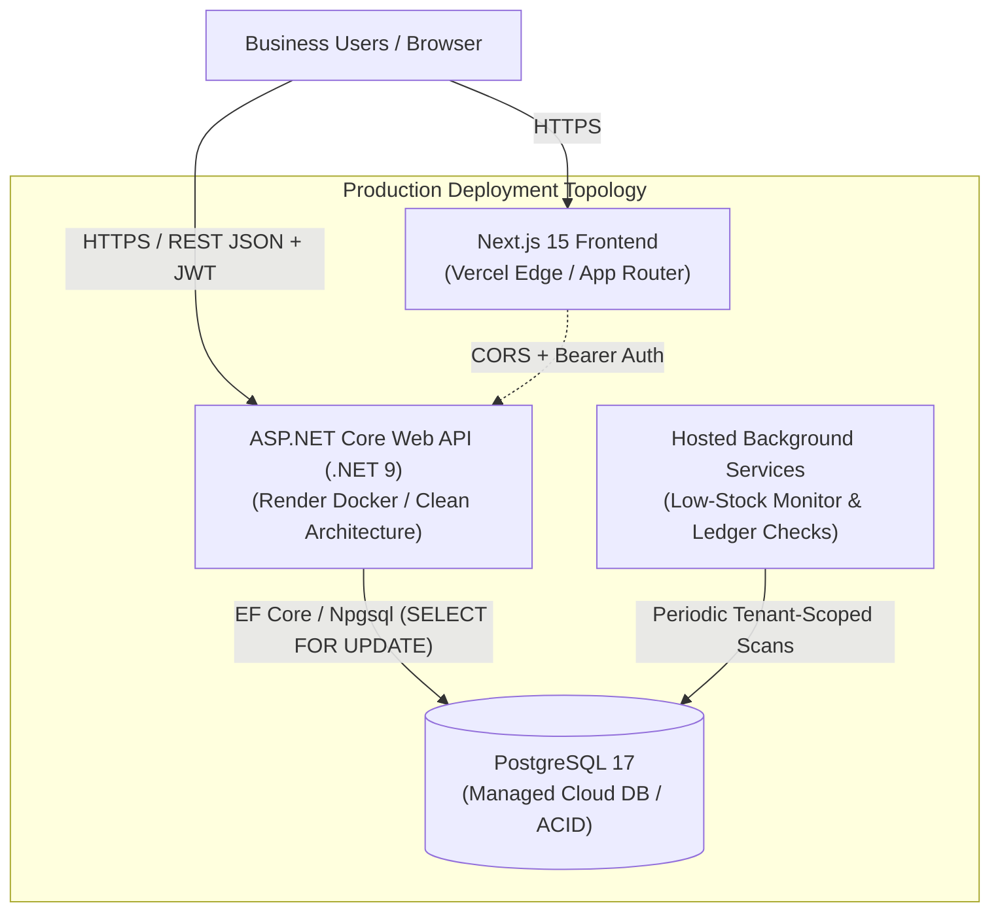
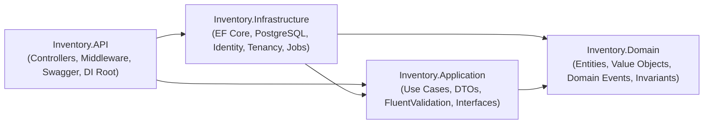

# Enterprise Inventory & Order Management SaaS

A production-oriented, multi-tenant **Enterprise Inventory & Order Management SaaS** built with **ASP.NET Core Web API (.NET 9)**, **Entity Framework Core**, **PostgreSQL**, **Next.js 15 (TypeScript, Tailwind CSS)**, and **Docker**.

---

## Live Deployment

- **Web Dashboard (Vercel):** [https://enterprise-inventory-and-order-mana.vercel.app](https://enterprise-inventory-and-order-mana.vercel.app)
- **Backend API & Swagger (Render):** [https://enterprise-inventory-and-order.onrender.com/swagger](https://enterprise-inventory-and-order.onrender.com/swagger)

> **Interactive Demo Workspace:** The login page includes 1-click auto-fill credentials for 6 distinct RBAC roles (`Owner`, `Warehouse Manager`, `Sales Representative`, `Procurement Officer`, `Inventory Clerk`, and `Compliance Auditor`) pre-seeded in `Acme Industrial Supply [DEMO]`.

---

## System & Deployment Architecture



### Clean Architecture Dependency Flow



---

## Core Engineering Capabilities

- **Multi-Tenant Isolation (Defense-in-Depth):** Shared-database, shared-schema tenancy enforced across 4 layers (Tenant Membership Middleware, Explicit Application Scoping, EF Core Global Query Filters, and a Write-Enforcement SaveChanges Interceptor).
- **Authoritative Inventory & Immutable Ledger Engine:**
  - Real-time tracking of `OnHandQuantity`, `ReservedQuantity`, `AvailableQuantity` (`OnHand - Reserved`), and `InTransitQuantity`.
  - Every balance mutation atomically writes an append-only `StockMovement` record with `BalanceBefore`, `QuantityDelta`, `BalanceAfter`, and `UnitCost`.
  - Database-level `CHECK` constraints guarantee non-negative balances and prevent `ReservedQuantity > OnHandQuantity`.
- **Concurrency & Race Condition Protection:**
  - Pessimistic row-level locking (`SELECT ... FOR UPDATE` with deterministic lock ordering by `WarehouseId, ProductId`) prevents deadlocks and overselling under concurrent order confirmations.
  - PostgreSQL `xmin` optimistic concurrency tokens on all mutable aggregate roots.
- **Transactional Order & Transfer Lifecycles:**
  - **Purchase Orders:** `Draft` -> `Submitted` -> `Approved` -> `PartiallyReceived` -> `Received` / `Cancelled` with automatic moving-average cost recalculation upon goods receipt.
  - **Sales Orders:** `Draft` -> `Pending` -> `Confirmed` (reserves stock) -> `Processing` -> `Fulfilled` (deducts stock) / `Cancelled` (releases active reservations).
  - **Stock Transfers:** `Draft` -> `Requested` -> `InTransit` -> `Received` / `Cancelled` across warehouses.
- **Idempotency Support:** Critical mutating endpoints support `Idempotency-Key` with SHA-256 request payload hash verification stored atomically in PostgreSQL.
- **Security & RBAC/PBAC:** JWT Access Tokens, Rotating Refresh Tokens with token-family reuse detection, fine-grained permission policies, rate limiting, and immutable `AuditLog` tracking.

---

## Repository Structure

```text
├── src/
│   ├── Inventory.Domain/           # Entities, Value Objects, Business Rules, Domain Invariants
│   ├── Inventory.Application/      # Use Cases, Services, DTOs, FluentValidation, Interfaces
│   ├── Inventory.Infrastructure/   # EF Core PostgreSQL, Identity, Tenancy, Jobs, Interceptors
│   └── Inventory.API/              # REST Controllers, Middleware, Filters, OpenAPI, DI Root
├── frontend/
│   └── inventory-web/              # Next.js Enterprise Dashboard (TypeScript, Tailwind, Lucide)
├── tests/
│   ├── Inventory.Domain.UnitTests/
│   ├── Inventory.Application.UnitTests/
│   ├── Inventory.API.IntegrationTests/
│   └── Inventory.ArchitectureTests/
└── docs/
    ├── architecture/               # C4, Clean Architecture & 4+1 Architectural Views
    ├── database/                   # ER Diagram, Schema, Constraints & Concurrency Strategy
    ├── api/                        # REST API Conventions & Specification
    ├── security/                   # Multi-Tenancy, Token Rotation & Threat Model
    ├── adr/                        # Architecture Decision Records (ADR-001 to ADR-006)
    └── deployment/                 # Docker Compose, Cloud PaaS, Migrations & Testing Guide
```

---

## Documentation Links

- [Architecture Overview, C4 & 4+1 Views](docs/architecture/overview.md)
- [Database Design, ER Diagram & Inventory Consistency](docs/database/schema-and-consistency.md)
- [REST API Specification](docs/api/api-specification.md)
- [Security & Multi-Tenancy Architecture](docs/security/security-and-multitenancy.md)
- [Architecture Decision Records (ADRs)](docs/adr/index.md)
- [Docker, Deployment & Operations Guide](docs/deployment/docker-and-operations.md)

---

## Quick Start

### 1. Run with Docker Compose
```bash
cp .env.example .env
docker compose up --build -d
```
- **Web Dashboard:** `http://localhost:3000`
- **API & Swagger Docs:** `http://localhost:8080/swagger`
- **Health Probes:** `http://localhost:8080/health/live` & `http://localhost:8080/health/ready`

### 2. Run Automated Tests
```bash
dotnet test Inventory.sln --configuration Release
```
