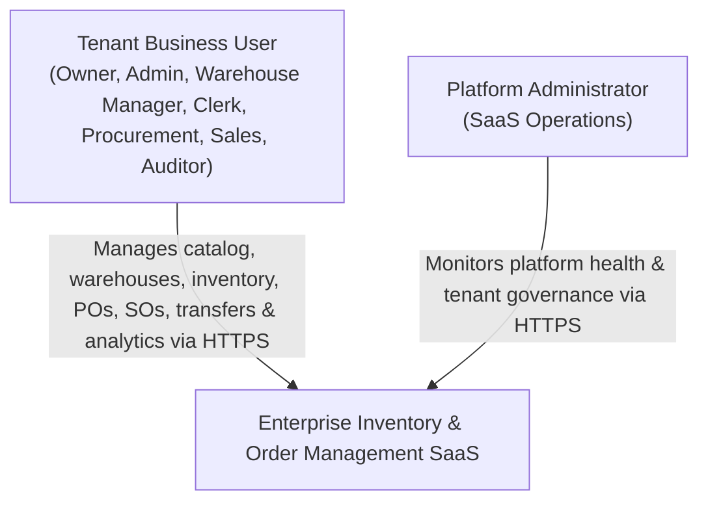
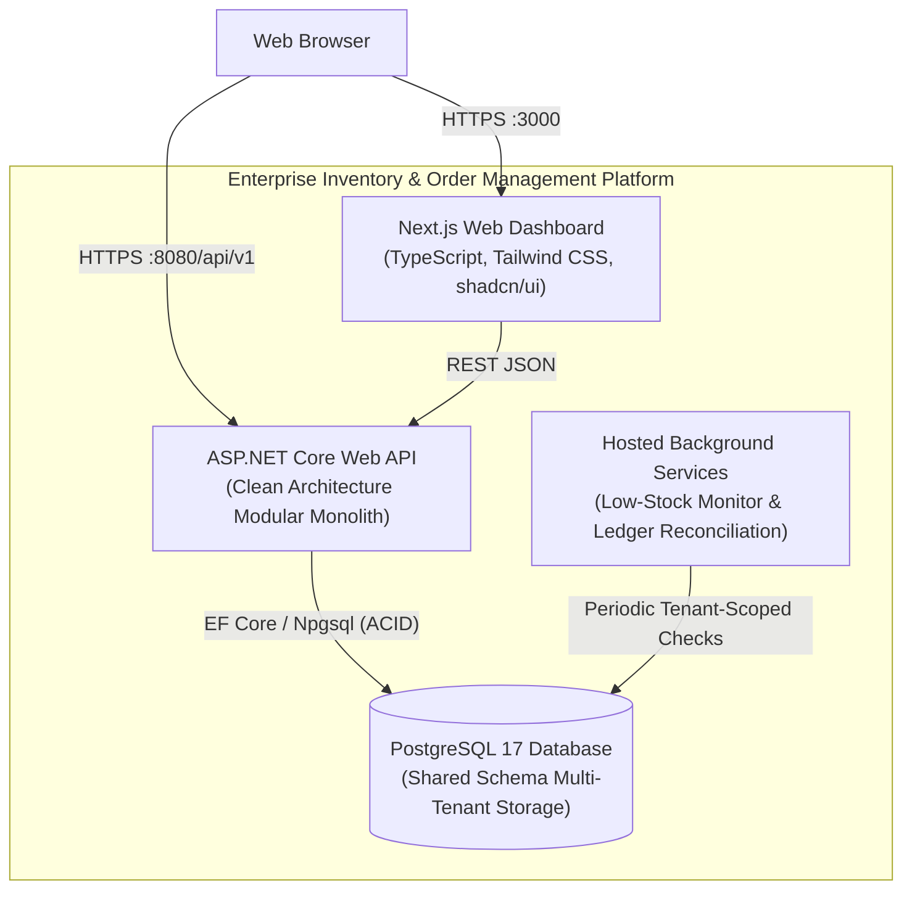
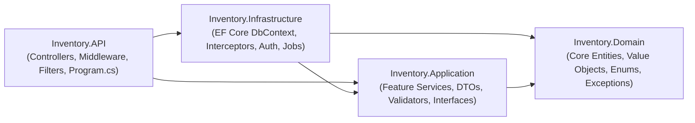
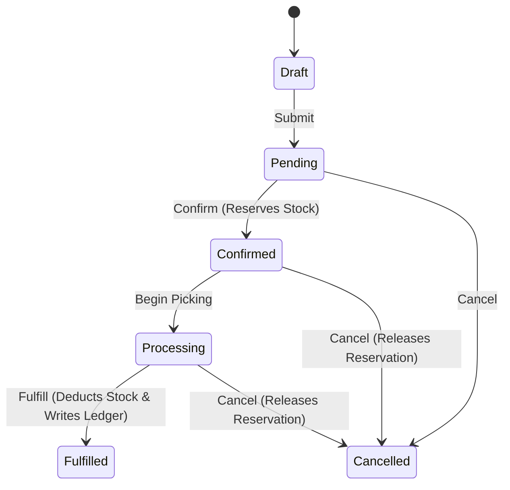
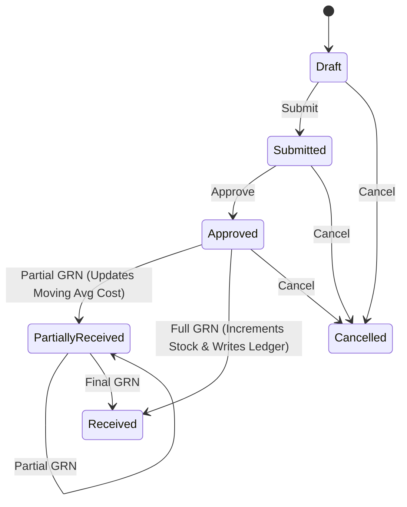
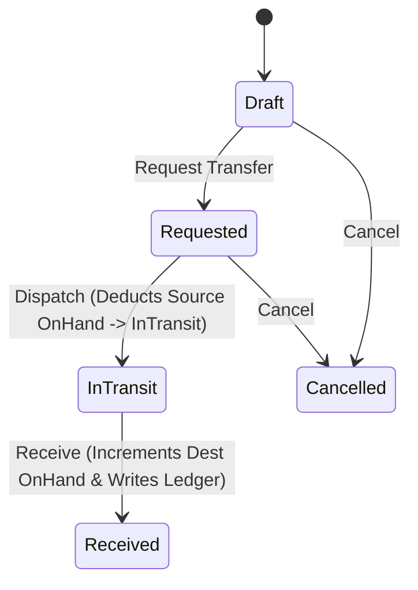

# Architecture Overview & 4+1 Views

## 1. System Vision & Architectural Style

The **Enterprise Inventory & Order Management SaaS** is a multi-tenant B2B platform engineered using **Clean Architecture**, **Modular Monolith**, and **Domain-Driven Design (DDD)** principles.

### Core Architectural Tenets
1. **Backend Authority:** The frontend is strictly a presentation client. All stock availability checks, price/total calculations, state transitions, and permission checks occur on the backend.
2. **Inward Dependency Flow:**
   - `Inventory.Domain` has zero external infrastructure dependencies.
   - `Inventory.Application` depends only on `Inventory.Domain`.
   - `Inventory.Infrastructure` implements persistence, identity, tenancy, and background jobs, depending on `Application` and `Domain`.
   - `Inventory.API` serves as the HTTP entry point and Dependency Injection composition root.
3. **Transactional Integrity:** Every stock change is executed atomically with an immutable `StockMovement` ledger record inside a PostgreSQL transaction.

---

## 2. C4 Architecture Diagrams

### C4 Level 1 — System Context



### C4 Level 2 — Container Diagram



---

## 3. 4+1 Architectural View Model

### 3.1 Logical View
The platform is partitioned into 11 cohesive modules:
1. **Identity & Access Management (`Identity`)**: Users, JWT generation, Refresh Token rotation & reuse detection, Role/Permission claims.
2. **Organization Management (`Organizations`)**: Multi-tenant workspaces, members, invitations, roles, workspace settings.
3. **Product Management (`Catalog`)**: Categories, Products, SKUs, pricing, reorder thresholds.
4. **Warehouse Management (`Warehouses`)**: Warehouses, addresses, internal bin locations.
5. **Inventory Management (`Inventory`)**: Materialized balances (`InventoryItem`), immutable ledger (`StockMovement`), active reservations (`StockReservation`), and cycle-count reconciliation (`InventoryReconciliation`).
6. **Supplier Management (`Suppliers`)**: Suppliers, contacts, and supplier-product catalog links.
7. **Purchase Order Management (`PurchaseOrders`)**: Procurement lifecycle and partial/full goods receipts (`GoodsReceipt`).
8. **Sales Order Management (`SalesOrders`)**: Customer order lifecycle, stock reservation, fulfillment, and cancellation release.
9. **Stock Transfer Management (`StockTransfers`)**: Multi-step inter-warehouse stock transfers (`Draft` -> `Requested` -> `InTransit` -> `Received`/`Cancelled`).
10. **Reporting & Analytics (`Reporting`)**: Valuation, low-stock alerts, movement history, warehouse performance, and order statistics.
11. **Audit & Activity Logs (`Auditing`)**: Append-only `AuditLog` and transactional `IdempotencyRecord`.

### 3.2 Development View (Clean Architecture Dependency Flow)



```text
src/
├── Inventory.Domain/          # Core Entities, Value Objects, Enums, Domain Exceptions
├── Inventory.Application/     # Feature Services, DTOs, Validators, Interfaces
├── Inventory.Infrastructure/  # EF Core DbContext, Configurations, Interceptors, Auth, Jobs
└── Inventory.API/             # REST Controllers, Middleware, Filters, Program.cs
frontend/
└── inventory-web/             # Next.js App Router Frontend
tests/
├── Inventory.Domain.UnitTests/
├── Inventory.Application.UnitTests/
├── Inventory.API.IntegrationTests/
└── Inventory.ArchitectureTests/
```

### 3.3 Process View (Domain State Machines)

#### Sales Order Lifecycle


#### Purchase Order Lifecycle


#### Stock Transfer Lifecycle


### 3.4 Physical View
- Deployed as multi-stage Docker containers (`inventory-db`, `inventory-api`, `inventory-web`) connected via an internal Docker bridge network with persistent volume storage for PostgreSQL and health check orchestration.

### 3.5 +1 Scenario View
Critical runtime scenarios (Organization Onboarding, Token Rotation, Product Creation, Goods Receipt, Sales Order Creation, Stock Reservation, Concurrent Reservation Contention, Order Cancellation, and Warehouse Transfer) are enforced through explicit database transactions and verified by integration tests in `Inventory.API.IntegrationTests`.
