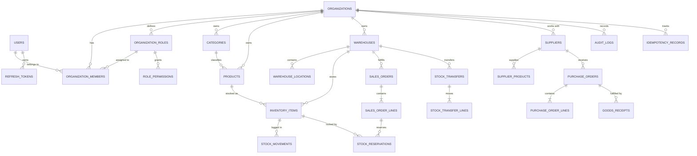
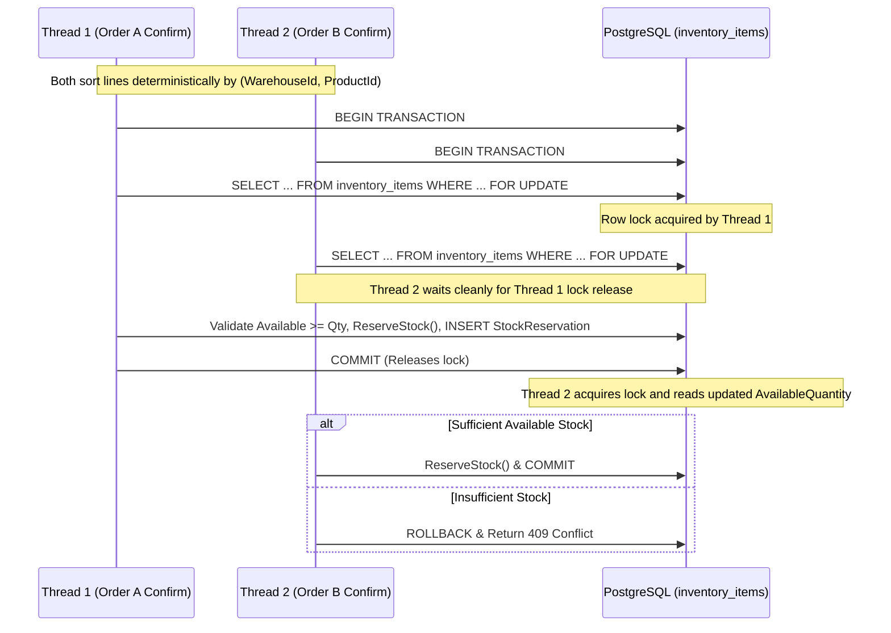

# Database Design, ER Diagram & Inventory Consistency Strategy

## 1. Entity-Relationship Diagram

---

## 2. Database Integrity & Check Constraints

All financial columns use `NUMERIC(18,4)` and all timestamps use `TIMESTAMPTZ` in UTC.

### Core Inventory Constraints (`inventory_items`)
- `UNIQUE (tenant_id, warehouse_id, product_id)`
- `CHECK (on_hand_quantity >= 0)`
- `CHECK (reserved_quantity >= 0)`
- `CHECK (in_transit_quantity >= 0)`
- `CHECK (reserved_quantity <= on_hand_quantity)`

### Immutable Stock Ledger Constraints (`stock_movements`)
- `CHECK (quantity_delta <> 0)`
- `CHECK (balance_before + quantity_delta = balance_after)`
- `CHECK (balance_after >= 0)`

---

## 3. Inventory Consistency & Concurrency Strategy

1. **Formula:** `AvailableQuantity = OnHandQuantity - ReservedQuantity`.
2. **Dual Persistence:** Every modification to `InventoryItem.OnHandQuantity` atomically inserts a `StockMovement` record in the same transaction.
3. **Deadlock-Free Pessimistic Locking:** Multi-line order confirmations, receipts, and transfers sort target items by `(WarehouseId, ProductId)` and execute `SELECT ... FOR UPDATE` on `inventory_items` inside an explicit transaction.
4. **Optimistic Concurrency Backup:** PostgreSQL `xmin` system column is mapped as a concurrency token on all mutable aggregate roots (`InventoryItem`, `Product`, `PurchaseOrder`, `SalesOrder`, `StockTransfer`).

