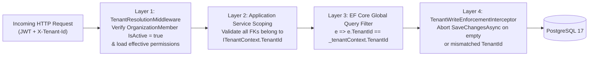
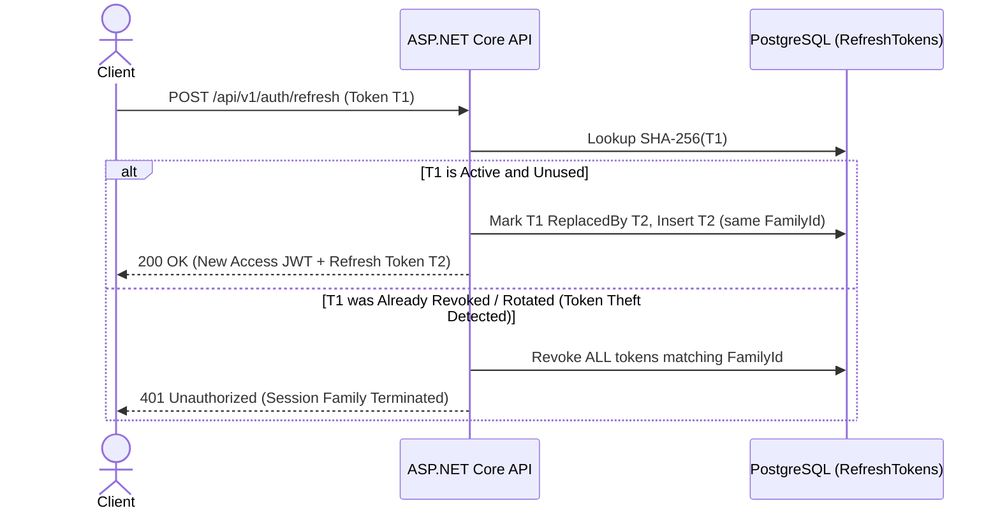

# Security & Multi-Tenancy Architecture

## 1. Defense-in-Depth Multi-Tenant Isolation

Global query filters alone are never relied upon as the sole tenant boundary. We enforce **4 independent layers of tenant isolation**:

1. **Layer 1 — Tenant Resolution & Membership Verification Middleware:**
   - Resolves `TenantId` from `X-Tenant-Id` header or the authenticated user's active `tenant_id` JWT claim.
   - Verifies that the authenticated user holds an active `OrganizationMember` record (`IsActive = true`) in that organization and loads their effective permissions for that tenant.
2. **Layer 2 — Explicit Application Service Scoping:**
   - Application services explicitly filter and validate foreign keys (such as `CategoryId`, `WarehouseId`, `SupplierId`, `ProductId`) against `ITenantContext.TenantId`.
3. **Layer 3 — EF Core Global Query Filters:**
   - Every entity implementing `ITenantEntity` has a global query filter `e => e.TenantId == _tenantContext.TenantId`.
4. **Layer 4 — `TenantWriteEnforcementInterceptor` on `SaveChangesAsync`:**
   - Before any `INSERT`, `UPDATE`, or `DELETE` is sent to PostgreSQL, the interceptor inspects `ChangeTracker.Entries<ITenantEntity>()` and aborts the transaction if any entity has an empty or mismatched `TenantId`.

---

## 2. Authentication & Token Security

- **Access Tokens:** Short-lived HMAC-SHA256 JWTs containing `sub` (`UserId`), `email`, `tenant_id`, and `role` claims.
- **Refresh Token Rotation & Reuse Detection:** Refresh tokens are hashed (`SHA-256`) before storage and grouped by `FamilyId`. If a previously rotated refresh token is presented again, the entire token family is immediately revoked to protect against token theft.

---

## 3. Audit Trail Protection
- All critical mutations write append-only `AuditLog` entries capturing `TenantId`, `ActorUserId`, `Action`, `EntityType`, `EntityId`, `BeforeJson`, `AfterJson`, `CorrelationId`, and `OccurredAtUtc`.
- No API endpoint or application service permits modifying or deleting audit log entries.
